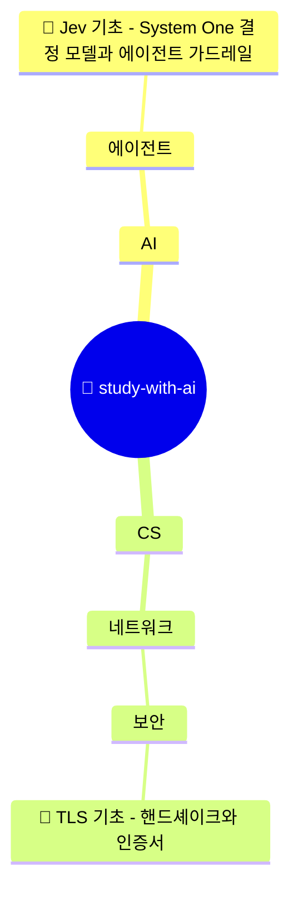

# 🌳 study-with-ai

AI에게 지도받으며(supervised) 공부하고, 공부를 마칠 때마다 지식나무에 잎을 하나씩 쌓습니다.

<!-- grow:start -->

> 🍃 잎 **2**개 · 🌱 공부 중 **0**개 · 📅 최근 공부 2026-11-14

## 🌳 지식나무

🍃 잎 바로가기 (펼치기)

<pre>
🌳 study-with-ai
├── AI
│   └── 에이전트
│       └── 🍃 <a href="tree/AI/%EC%97%90%EC%9D%B4%EC%A0%84%ED%8A%B8/2026-11-14-Jev-%EA%B8%B0%EC%B4%88-System-One-%EA%B2%B0%EC%A0%95-%EB%AA%A8%EB%8D%B8%EA%B3%BC-%EC%97%90%EC%9D%B4%EC%A0%84%ED%8A%B8-%EA%B0%80%EB%93%9C%EB%A0%88%EC%9D%BC/README.md">Jev 기초 - System One 결정 모델과 에이전트 가드레일</a> · 2026-11-14
└── CS
    └── 네트워크
        └── 보안
            └── 🍃 <a href="tree/CS/%EB%84%A4%ED%8A%B8%EC%9B%8C%ED%81%AC/%EB%B3%B4%EC%95%88/2026-11-10-TLS-%EA%B8%B0%EC%B4%88-%ED%95%B8%EB%93%9C%EC%85%B0%EC%9D%B4%ED%81%AC%EC%99%80-%EC%9D%B8%EC%A6%9D%EC%84%9C/README.md">TLS 기초 - 핸드셰이크와 인증서</a> · 2026-11-10
</pre>

## 🌱 공부 중

지금 공부 중인 노트가 없어요.

## 🍃 최근 쌓인 잎

| 날짜 | 가지 | 노트 |
|---|---|---|
| 2026-11-14 | AI / 에이전트 | [Jev 기초 - System One 결정 모델과 에이전트 가드레일](tree/AI/%EC%97%90%EC%9D%B4%EC%A0%84%ED%8A%B8/2026-11-14-Jev-%EA%B8%B0%EC%B4%88-System-One-%EA%B2%B0%EC%A0%95-%EB%AA%A8%EB%8D%B8%EA%B3%BC-%EC%97%90%EC%9D%B4%EC%A0%84%ED%8A%B8-%EA%B0%80%EB%93%9C%EB%A0%88%EC%9D%BC/README.md) |
| 2026-11-10 | CS / 네트워크 / 보안 | [TLS 기초 - 핸드셰이크와 인증서](tree/CS/%EB%84%A4%ED%8A%B8%EC%9B%8C%ED%81%AC/%EB%B3%B4%EC%95%88/2026-11-10-TLS-%EA%B8%B0%EC%B4%88-%ED%95%B8%EB%93%9C%EC%85%B0%EC%9D%B4%ED%81%AC%EC%99%80-%EC%9D%B8%EC%A6%9D%EC%84%9C/README.md) |

<!-- grow:end -->
