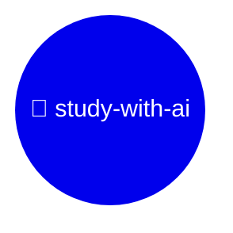

# 🌳 study-with-ai

AI에게 지도받으며(supervised) 공부하고, 공부를 마칠 때마다 지식나무에 잎을 하나씩 쌓습니다.

<!-- grow:start -->

> 🍃 잎 **0**개 · 🌿 가지 **0**개 · 🌱 공부 중 **0**개 · 📅 최근 공부 -

## 🌳 지식나무

아직 잎이 없어요. 첫 공부를 마치면 여기에 🍃가 돋아나요.

## 🌱 공부 중

지금 공부 중인 노트가 없어요.

## 🍃 최근 쌓인 잎

아직 없어요.

<!-- grow:end -->
