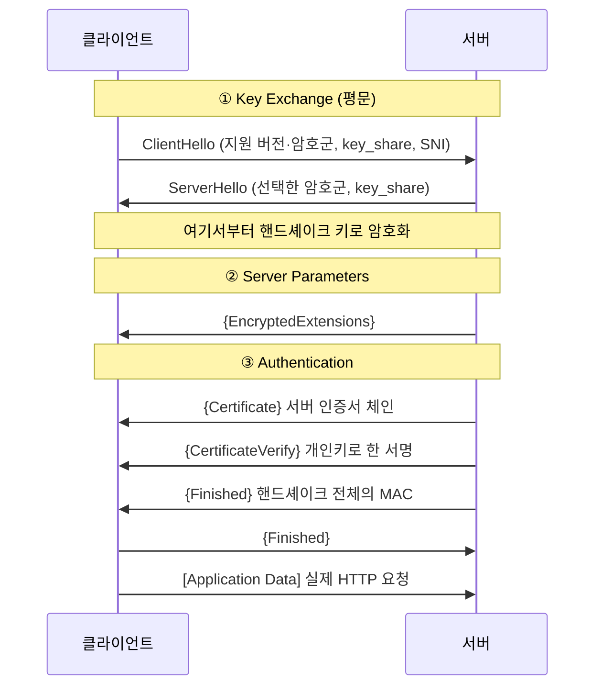

<!-- supervised: status=studying started=2026-11-10 -->
# TLS 기초 - 핸드셰이크와 인증서

> 가지: CS / 네트워크 / 보안

## 개념 설명

### 왜 필요한가
TCP는 바이트를 순서대로 전달할 뿐, 중간에서 **누가 엿보거나**, **내용을 바꾸거나**, **상대인 척하는 것**을 막지 못한다.
TLS(Transport Layer Security)는 TCP 위에서 이 세 가지를 해결한다.

| 보장 | 의미 | 어떻게 |
|---|---|---|
| 기밀성 (Encryption) | 중간자가 내용을 읽을 수 없음 | 핸드셰이크로 만든 대칭키로 암호화 (예: AES-GCM) |
| 무결성 (Integrity) | 내용이 바뀌면 바로 들킴 | AEAD 암호의 인증 태그 |
| 인증 (Authentication) | 접속한 서버가 진짜임 | 서버 인증서 + CA 서명 체인 + 개인키 서명 |

HTTPS = HTTP over TLS. TCP 3-way handshake로 연결을 연 **다음에** TLS 핸드셰이크가 이어진다.

### 어떻게 동작하나 — TLS 1.3 핸드셰이크 (1-RTT)
RFC 8446은 핸드셰이크를 세 단계로 나눈다: **Key Exchange → Server Parameters → Authentication**.



1. **ClientHello**: 클라이언트가 "TLS 1.3 되고, 이 암호군들 되고, 내 Diffie-Hellman 공개값(`key_share`)은 이거야"를 한 번에 보낸다. `server_name`(SNI)으로 접속하려는 도메인도 알린다.
2. **ServerHello**: 서버가 하나를 골라 자기 `key_share`를 보낸다. 이제 양쪽 모두 (EC)DHE로 **같은 공유 비밀**을 계산할 수 있고, 여기서 HKDF로 키를 뽑는다. 그래서 이 뒤의 메시지(`{...}`)는 전부 암호화된다.
3. **Certificate + CertificateVerify**: 서버가 인증서를 보내고, 그 인증서의 개인키로 지금까지의 핸드셰이크에 서명한다. → "이 인증서의 진짜 주인이 지금 나랑 말하고 있다"가 증명된다.
4. **Finished**: 양쪽이 핸드셰이크 전체에 대한 MAC을 교환해서 중간에 아무도 메시지를 바꾸지 않았음을 확인한다.

**TLS 1.2와의 차이**
- 1.2는 핸드셰이크에 2-RTT, 1.3은 1-RTT. ClientHello에 key_share를 미리 실어 보내기 때문이다.
- 1.3은 RSA 키 전송 같은 정적 키 교환을 없애고 (EC)DHE만 남겼다. → 서버 개인키가 나중에 유출돼도 과거 트래픽은 못 푼다(**전방 비밀성**, forward secrecy).
- 1.3은 서버 인증서까지 암호화해서 보낸다. 1.2는 평문이었다.

### 인증서는 왜 믿을 수 있나 — 신뢰 체인
```
[루트 CA]  ← OS/브라우저에 미리 설치돼 있음 (신뢰의 출발점)
    │ 서명
[중간 CA]  ← 서버가 같이 보내줌
    │ 서명
[서버 인증서]  CN/SAN = example.com
```
클라이언트는 ① 서명이 루트까지 이어지는지, ② 유효기간 안인지, ③ **SAN에 내가 접속한 도메인이 있는지**를 확인한다. 하나라도 틀리면 연결을 끊는다(브라우저의 "연결이 비공개로 설정되어 있지 않습니다").
자체 서명(self-signed) 인증서는 ①에서 실패한다 — 발급자가 자기 자신이고, 그 "루트"를 아무도 신뢰 목록에 넣지 않았기 때문이다.

### 예시 — 실제로 본 example.com
이 노트를 만들 때 `openssl s_client -msg`로 example.com에 붙어서 본 메시지 순서:
```
>>> ClientHello
<<< ServerHello
<<< EncryptedExtensions
<<< Certificate
<<< CertificateVerify
<<< Finished
>>> Finished
```
위 다이어그램과 똑같다. 협상된 그룹은 `X25519MLKEM768`이었다. 기존 X25519에 양자내성 KEM(ML-KEM)을 섞은 하이브리드 키 교환이다.

## 핵심 요약
- TLS는 TCP 위에서 **기밀성·무결성·인증**을 제공한다. HTTPS = HTTP + TLS.
- TLS 1.3 핸드셰이크는 **1-RTT**: ClientHello/ServerHello로 키를 합의하고, 그 뒤 메시지는 모두 암호화된다.
- 키 교환은 항상 **(EC)DHE** → 전방 비밀성. 대칭키는 HKDF로 파생한다.
- 서버는 **Certificate**(누구인지) + **CertificateVerify**(개인키를 가졌다는 증명)로 자신을 인증한다.
- 인증서 검증 = 서명 체인이 신뢰 루트까지 + 유효기간 + **SAN에 도메인 포함**.
- TLS 1.3 표준은 RFC 8446(2018)이었고, 2026년 7월 같은 버전 번호를 유지한 소폭 개정판 **RFC 9846**으로 대체됐다.
- TLS 1.0/1.1은 쓰면 안 되고, 1.2는 아직 일부 사용, 1.3이 주류다.

## 참고자료
- [RFC 9846 — The TLS Protocol Version 1.3](https://datatracker.ietf.org/doc/rfc9846/) — 현재 TLS 1.3 표준 (2026-07, RFC 8446 대체, 하위 호환)
- [RFC 8446 — The TLS Protocol Version 1.3](https://www.rfc-editor.org/rfc/rfc8446) — 원래 TLS 1.3 표준. 2장 Protocol Overview와 Figure 1이 핸드셰이크 전체 그림
- [MDN — Transport Layer Security](https://developer.mozilla.org/en-US/docs/Web/Security/Transport_Layer_Security) — 웹 개발자 관점의 TLS 개요, 버전 현황, HSTS

## TODO 실습
- [ ] 실제 사이트에 TLS로 붙어서 협상 결과 보기
  - 실행: `echo | openssl s_client -connect example.com:443 -servername example.com -brief`
  - 확인: 출력에 `Protocol version: TLSv1.3`, `Ciphersuite: TLS_AES_...`, `Verification: OK`가 보이면 성공. `Negotiated TLS1.3 group`이 무엇인지도 적어 보기
- [ ] 핸드셰이크 메시지 순서를 직접 관찰하기
  - 실행: `echo | openssl s_client -connect example.com:443 -servername example.com -msg 2>&1 | grep -E '^(<<<|>>>)'`
  - 확인: `ClientHello → ServerHello → EncryptedExtensions → Certificate → CertificateVerify → Finished → Finished` 순서가 보이고, 위 다이어그램의 어느 단계인지 각각 말할 수 있으면 성공
- [ ] Python으로 TLS 클라이언트를 돌리고 인증서 읽기
  - 실행: `python3 lab/tls_client.py example.com` (노트 폴더에서)
  - 확인: 버전·암호군·발급자·SAN이 출력되면 성공. 이어서 `python3 lab/tls_client.py expired.badssl.com`을 실행해 `certificate has expired` 오류가 나는지 보고, 코드의 어느 줄이 검증을 켜는지 찾기. 마지막으로 파일 아래 TODO 주석을 풀어 HTTP 응답 첫 줄(`HTTP/1.1 200 OK` 등)이 찍히게 하기
- [ ] 자체 서명 인증서로 내 TLS 서버를 띄우고 "신뢰"를 체험하기
  - 실행 (lab 폴더에서, 터미널 2개):
    ```bash
    # 터미널 1: 인증서 만들고 서버 띄우기
    openssl req -x509 -newkey ec -pkeyopt ec_paramgen_curve:P-256 -nodes \
      -keyout key.pem -out cert.pem -days 7 \
      -subj "/CN=localhost" -addext "subjectAltName=DNS:localhost"
    openssl s_server -accept 8443 -cert cert.pem -key key.pem -www -tls1_3
    # 터미널 2
    curl https://localhost:8443/                      # ①
    curl --cacert cert.pem https://localhost:8443/    # ②
    ```
  - 확인: ①은 `curl: (60) ... self-signed certificate`로 실패하고, ②는 성공해서 출력에 `TLSv1.3`이 보이면 성공. ①과 ②의 차이를 "신뢰 체인" 관점에서 한 문장으로 설명해 보기
- [ ] 버전 협상이 실패하는 경우 보기
  - 실행: 위 서버(`-tls1_3`)를 띄운 채 `echo | openssl s_client -connect localhost:8443 -tls1_2`
  - 확인: `alert protocol version` 오류가 나면 성공. 왜 실패하는지(서버가 1.3만, 클라이언트는 1.2만 제시) 설명할 수 있으면 완료

## 질문과 답

아직 질문이 없어요. 공부하다 생긴 질문은 여기에 쌓여요.
